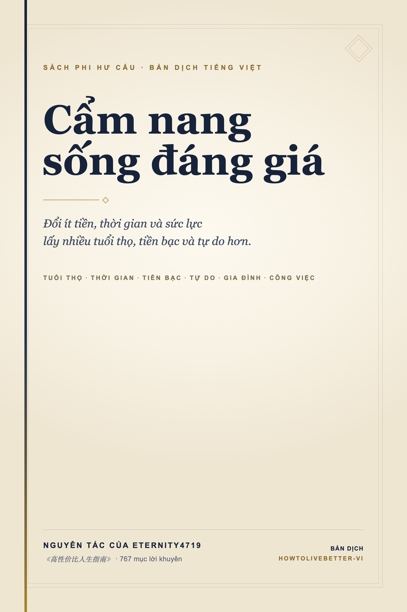

<div align="center">



# Cẩm nang sống đáng giá

**Bản dịch tiếng Việt của《高性价比人生指南》 (*HowToLiveBetter*)**  
Nguyên tác: **eternity4719** · Bản dịch: **nhóm HowToLiveBetter-vi**

[](https://github.com/thuongtin/HowToLiveBetter/releases/latest/download/HowToLiveBetter-vi.epub)
[](vi/manifest.json)
[](vi/qa/epubcheck.txt)
[](https://creativecommons.org/licenses/by/4.0/)

**[Tải EPUB](https://github.com/thuongtin/HowToLiveBetter/releases/latest/download/HowToLiveBetter-vi.epub)** · [Trang phát hành](https://github.com/thuongtin/HowToLiveBetter/releases) · [Nguồn và cách dựng](vi/README.md) · [Báo cáo kiểm tra](vi/qa/final-report.md)

</div>

---

## Đây là sách gì

Cuốn sách tính chuyện sống thế nào cho đáng: bỏ ra ít tiền, thời gian và sức lực để đổi lấy nhiều tuổi thọ, tiền bạc và tự do hơn. Sách gồm **34 chương, 767 mục** và **9 bài dài**, viết cho người sống ở Trung Quốc đại lục.

Mỗi mục trả lời hai câu: phải bỏ ra gì, và được lại gì. Sáu trường được giữ đầy đủ trong bản dịch:

- **Chi phí**
- **Nói dễ hiểu**
- **Lợi ích**
- **Mức chứng cứ** (A/B/C)
- **Nguồn** (giữ nguyên tiếng Trung, URL, DOI, số hiệu văn bản để đối chiếu)
- **Ghi chú**

Bản tiếng Việt không thay quy định Trung Quốc bằng quy định Việt Nam. Mục nào chỉ đúng ở Trung Quốc đại lục sẽ mở đầu phần «Ghi chú» bằng câu **«Chỉ áp dụng ở Trung Quốc:»**.

## Tải và đọc

- **EPUB mới nhất**: [HowToLiveBetter-vi.epub](https://github.com/thuongtin/HowToLiveBetter/releases/latest/download/HowToLiveBetter-vi.epub) — EPUB 3, reflowable, ngôn ngữ `vi`.
- **Bản phát hành hiện tại**: [v1.0.2 — tương phản cao cho Boox/màn hình màu](https://github.com/thuongtin/HowToLiveBetter/releases/tag/vi-v1.0.2).
- **Bản tiếng Trung gốc**: [README.zh.md](README.zh.md) và [kho nguyên tác](https://github.com/eternity4719/HowToLiveBetter).

Thiết kế dùng chữ đen trên nền trắng, callout viền đen, không dùng chữ xám nhạt — để đọc rõ trên Boox màu và màn hình e-ink.

## Mục lục

| # | Chương |
| --- | --- |
| 1 | [1. Đừng chết sớm](vi/book/01-dung-chet-som.md) |
| 2 | [2. Đừng chết từ từ](vi/book/02-dung-chet-tu-tu.md) |
| 3 | [3. Đừng lãng phí sức lực](vi/book/03-dung-lang-phi-suc-luc.md) |
| 4 | [4. Đừng lãng phí thời gian](vi/book/04-dung-lang-phi-thoi-gian.md) |
| 5 | [5. Đừng lãng phí tiền](vi/book/05-dung-lang-phi-tien.md) |
| 6 | [6. Danh sách nên tránh](vi/book/06-danh-sach-nen-tranh.md) |
| 7 | [7. Sống khi không có tiền](vi/book/07-song-khi-khong-co-tien.md) |
| 8 | [8. Đừng tự chuốc họa vào thân: pháp luật và an toàn tài sản](vi/book/08-dung-tu-chuoc-hoa-vao-than.md) |
| 9 | [9. Làn ranh đỏ pháp luật người thường dễ vi phạm](vi/book/09-lan-san-do-phap-luat-de-vi-pham.md) |
| 10 | [10. Yêu và cưới có đáng không](vi/book/10-yeu-va-cuoi-co-dang-khong.md) |
| 11 | [11. Làn ranh đỏ dân lập trình và dân kỹ thuật dễ vi phạm](vi/book/11-lan-san-do-cua-dan-ky-thuat.md) |
| 12 | [12. Khởi nghiệp và làm ăn: đừng đem gia sản đổ vào](vi/book/12-khoi-nghiep-va-lam-an.md) |
| 13 | [13. Tình huống khẩn cấp: làm gì trước](vi/book/13-tinh-huong-khan-cap.md) |
| 14 | [14. Tài khoản và an toàn thông tin](vi/book/14-tai-khoan-va-an-toan-thong-tin.md) |
| 15 | [15. Thuê nhà và mua nhà](vi/book/15-thue-va-mua-nha.md) |
| 16 | [16. Sống sau khi mắc bệnh mạn tính](vi/book/16-song-sau-khi-mac-benh-man-tinh.md) |
| 17 | [17. Nhà có người già](vi/book/17-nha-co-nguoi-gia.md) |
| 18 | [18. Nuôi con có đáng không](vi/book/18-nuoi-con-co-dang-khong.md) |
| 19 | [19. Đang làm việc, nghỉ việc và tai nạn lao động](vi/book/19-di-lam-nghi-viec-va-tai-nan-lao-dong.md) |
| 20 | [20. Chăm trẻ sơ sinh thế nào](vi/book/20-cham-tre-so-sinh.md) |
| 21 | [21. Đi nước ngoài, du lịch và an toàn ở nước ngoài](vi/book/21-du-lich-va-an-toan-nuoc-ngoai.md) |
| 22 | [22. Thư giãn thế nào: chỗ giải trí và giảm áp lực](vi/book/22-thu-gian-the-nao.md) |
| 23 | [23. Học kỹ năng gì thì đáng](vi/book/23-hoc-ky-nang-gi-dang.md) |
| 24 | [24. Đi khám bệnh: sao cho ít tốn tiền ít đi đường vòng](vi/book/24-di-kham-benh.md) |
| 25 | [25. Người thân qua đời rồi phải làm những việc gì](vi/book/25-viec-phai-lam-khi-nguoi-than-qua-doi.md) |
| 26 | [26. Làm một website hay nền tảng: tư cách, đăng ký và máy chủ](vi/book/26-lam-mot-website-hoac-nen-tang.md) |
| 27 | [27. Mang thai và sinh con: từ phát hiện có thai đến xuất viện làm giấy](vi/book/27-mang-thai-va-sinh-con.md) |
| 28 | [28. Đừng vì ngoại hình phá hỏng sức khỏe](vi/book/28-dung-vi-ngoai-hinh-pha-hong-suc-khoe.md) |
| 29 | [29. Sau khi gặp cú sốc lớn](vi/book/29-sau-khi-gap-cu-soc-lon.md) |
| 30 | [30. Con cái tuổi đi học](vi/book/30-con-cai-tuoi-di-hoc.md) |
| 31 | [31. Sau mười tám tuổi có những con đường nào](vi/book/31-nhung-con-duong-sau-tuoi-muoi-tam.md) |
| 32 | [32. Du học nước ngoài: tư cách lưu trú, làm thêm, bảo hiểm và công nhận bằng khi về nước](vi/book/32-du-hoc-nuoc-ngoai.md) |
| 33 | [33. Sống thế nào sau khi khuyết tật](vi/book/33-song-sau-khi-khuyet-tat.md) |
| 34 | [34. Thuốc thường dùng trong nhà, đừng để uống thành tai họa](vi/book/34-thuoc-san-trong-nha-dung-de-uong-thanh-hoa.md) |

## Bài dài

- [Cưới có đáng không: tách một khoản mù mờ thành năm khoản rõ ràng](vi/docs/cuoi-co-dang-khong.md)
- [Danh mục đồ dùng khẩn cấp gia đình: mua gì, để đâu, bao lâu kiểm tra một lần](vi/docs/danh-muc-do-dung-khan-cap-gia-dinh.md)
- [Trên đường thấy người lạ gặp chuyện, bỏ đi hay dừng lại](vi/docs/gap-nguoi-la-bi-nan-co-nen-dung-lai.md)
- [Làm nền tảng cần những giấy phép gì: bảng đối chiếu và bảng quyết định chọn máy chủ](vi/docs/lam-nen-tang-can-nhung-giay-phep-gi.md)
- [Cơ thể nhận biết thời gian thế nào, và vì sao ca đêm lại có hại](vi/docs/nhip-dong-ho-sinh-hoc-va-ca-dem.md)
- [Bị cắt giảm nhân sự rồi, làm gì trước](vi/docs/bi-cat-giam-roi-lam-gi-truoc.md)
- [Việc cần làm trước và sau khi sinh con: danh sách xếp theo thời gian](vi/docs/viec-can-lam-truoc-va-sau-khi-sinh-con.md)
- [Vừa được chẩn đoán bệnh mạn tính: tuần đầu, ba tháng đầu và về sau làm gì](vi/docs/vua-chan-doan-benh-man-tinh.md)
- [Trước khi đổi việc, đổi thành phố: mấy cuốn sổ phải tính và mấy thủ tục phải làm](vi/docs/truoc-khi-doi-viec-doi-thanh-pho.md)

## Chất lượng và giới hạn

- **767/767 mục**, 34/34 chương, 9/9 bài dài; audit 0 thiếu số, 0 lệch nguồn.
- **EPUBCheck 5.4.0: 0 lỗi, 0 cảnh báo**; 2.364 liên kết nội bộ, 0 hỏng.
- Đã soát độc lập 34 chương và 9 bài dài; sửa các lỗi ngưỡng điều luật, sai chủ thể, thuật ngữ y khoa và DOI.
- **Chưa có người bản ngữ đọc toàn bộ.** Mới kiểm tra bằng EPUBCheck và Chromium; chưa thử trực tiếp Apple Books, Kindle, Kobo, Thorium, Calibre.
- 2.575 liên kết ngoài chưa kiểm tra trực tuyến.
- Nội dung y khoa/pháp luật là bản dịch trung thành của nguyên tác Trung Quốc, không phải lời khuyên độc lập cho Việt Nam.

Chi tiết: [báo cáo phát hành](vi/qa/final-report.md) · [sổ lỗi](vi/qa/corrections.md) · [kiểm tra thị giác](vi/qa/visual.md) · [manifest](vi/manifest.json).

## Dựng lại

```bash
npm --prefix tools/vi ci
node tools/vi/make-cover.mjs
node tools/vi/build-epub.mjs
java -jar /path/to/epubcheck.jar dist/HowToLiveBetter-vi.epub
```

Hướng dẫn đầy đủ: [vi/README.md](vi/README.md).

## Giấy phép và ghi công

- Nguyên tác và bản dịch: **CC BY 4.0**.
- Bản dịch kế thừa bản cộng đồng của **chuanman2707** (CC BY 4.0), sau đó được đối chiếu và dịch lại theo nguyên tác hiện hành.
- Phông chữ: Literata, Be Vietnam Pro, Cormorant Garamond (SIL OFL 1.1).

Đây là ấn bản không chính thức, không liên kết với nhà xuất bản của bản tiếng Trung.

---

<sub>Bản tiếng Trung gốc của kho này: [README.zh.md](README.zh.md).</sub>
